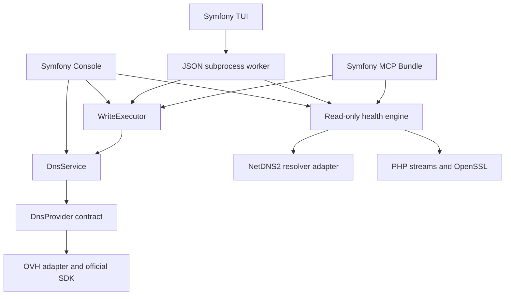

# Architecture

ZoneHarbor keeps operation policy in application services so CLI, TUI and MCP share behavior.

## Why these boundaries

- `DnsProvider` deals in typed zones, records and partial mutations. Record references are opaque strings, TTL `null` means provider default, and RDATA is preserved. The OVH adapter owns numeric ID validation and SDK field mapping. Legacy CLI/MCP serializers retain the original OVH wire fields.
- Capabilities declare record types, explicit publication and native export. Unsupported actions fail explicitly. Providers without explicit publication apply changes immediately. Their normalized backup is still mandatory.
- `WriteExecutor` owns validation, account/provider/zone locking, backups, durable intent, stale-preview checks and publication outcomes. OVH native export failure prevents mutation. A failed refresh never retries the record mutation. Unknown outcomes carry a typed flag, independent of display language.
- The official `ovh/ovh` SDK handles authentication and request signing. Reimplementing that protocol would add maintenance without helping the DNS model. The adapter sanitizes transport errors and never forwards secrets or raw responses.
- Health checks are independent of account credentials. Injectable DNS, TLS and clock interfaces make findings deterministic in tests. NetDNS2 supplies a maintained pure-PHP DNS implementation without requiring `dig`; PHP/OpenSSL supplies the platform trust store and SNI.
- TUI reads and writes run in a subprocess, keeping terminal input responsive. Reads can be cancelled; active writes must finish or be inspected afterward.
- HTTP MCP is a narrow authenticated endpoint, not a web admin panel. `/healthz` is liveness only; it never calls OVH or scans domains.

## Adding a provider

Implement `OvhDns\Provider\DnsProvider`, including sanitized errors and `Capabilities`. Preserve exact RDATA and provider metadata, map default TTL explicitly, validate references before network access and never retry uncertain writes. Wire the provider into `DnsService`; `tests/ProviderTest.php` and its in-memory implementation demonstrate the contract. Supply adapter tests and run the same operation safety tests against the new provider.

Only OVH is wired into production in v0.1.0. There is no plugin loader or multi-account UI. A second real provider should drive those decisions. The existing `OvhDns` PHP namespace is retained for source compatibility; product and lowercase identifiers are **ZoneHarbor** and **zone-harbor**.

## Onboarding and portable installations

`UserConfiguration` validates the versioned YAML with the shipped JSON Schema and health/DNS semantic checks. `Configuration` supplies the same selection to CLI, TUI workers and MCP. Config selection is parsed using the actual command definition, so record values cannot be mistaken for launcher options.

Setup, diagnostics and client configuration generation use this shared model. They remain available when the selected configuration is missing or invalid. The wizard uses SymfonyStyle; MCP startup follows its own non-interactive command and never enters the wizard. Public-health mode blocks real writes in the shared coordinator as well as disabling provider initialization.

Atomic file updates hold a lock while reading/merging and replacing. Config and client backups use 0600. New credentials are staged in a separate file before configuration activation; stale wizard saves fail. Generated MCP settings contain paths and launcher arguments, never credential values. User state is external to the application, with cache namespaces per configuration and installation/version.

The release bundle packages the same source and locked production dependencies. The Docker onboarding service uses the same launcher and a private named configuration volume. Remote HTTP deployment remains separate from the local setup wizard.
